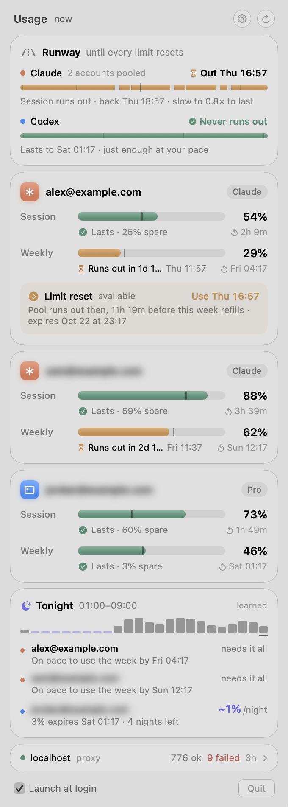
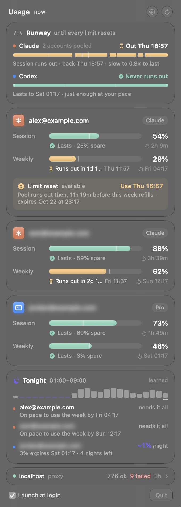
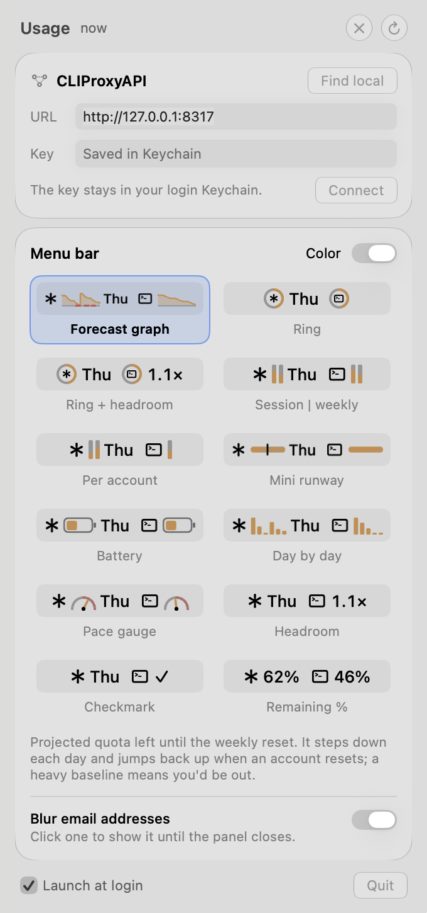

# SubPacer

Pace your Claude and Codex subscription limits. A macOS menu bar app that shows the quota of every account in your [CLIProxyAPI](https://github.com/router-for-me/CLIProxyAPI) and forecasts whether your pace makes it to the next reset.

<p align="center">
  
</p>
<p align="center">
  
  
</p>

- **Per-account quota**: session and weekly limits, when they reset, and whether your current pace runs out first.
- **Runway**: pools each provider's accounts (the proxy fails over between them) and simulates forward to the last weekly reset, following your activity pattern and letting limits refill as they reset. Shows whether you ever run out, when, and how much faster or slower you could go.
- **Menu bar**: twelve styles, from a forecast graph to a plain percentage, previewed live with your numbers.
- **Quiet hours**: learns when you use the proxy and shows how much weekly quota will expire unused each night.
- **Limit resets**: shows one-off Claude limit-reset grants and when spending one buys the most.
- **Private by default**: account emails are blurred until you click them.

> **Unofficial.** Quota comes from the providers' own, undocumented usage endpoints (the ones their CLIs use). They can change or disappear without notice. Not affiliated with Anthropic, OpenAI or the CLIProxyAPI project.

## Requirements

- macOS 26 or later, Apple silicon or Intel
- A running CLIProxyAPI with Claude and/or Codex accounts signed in

## Install

Download `SubPacer-<version>.zip` from [Releases](https://github.com/kcazin/SubPacer/releases), unzip it and move `SubPacer.app` to Applications.

The app isn't notarized, so macOS blocks it the first time. Either open it once, then click **Open Anyway** in System Settings → Privacy & Security, or clear the download flag:

```sh
xattr -dr com.apple.quarantine /Applications/SubPacer.app
```

### Build from source

Needs Swift 6.2 (Xcode 26 or its command line tools).

```sh
git clone https://github.com/kcazin/SubPacer.git
cd SubPacer
./build.sh                    # builds for this Mac, signs ad hoc, installs ~/Applications/SubPacer.app
open ~/Applications/SubPacer.app
```

`./build.sh --release 0.1.0` builds the universal app and zip in `dist/` instead.

### Try it without a proxy

```sh
SUBPACER_DEMO=1 /Applications/SubPacer.app/Contents/MacOS/SubPacer
```

runs on made-up accounts (two Claude, one Codex) with a week of synthetic history. Nothing is saved.

## Connect to your proxy

SubPacer uses CLIProxyAPI's management API, which is off until it has a key. In the proxy's `config.yaml`:

```yaml
remote-management:
  secret-key: "pick-a-long-random-key"   # the proxy hashes this on its next start
  allow-remote: false                    # true only if SubPacer runs on another machine
```

Restart the proxy, then click the SubPacer menu bar icon. On first run it shows a setup card:

1. **Find local** looks for a proxy on this Mac (port 8317, plus any `port:` from a `config.yaml` in `~/.cli-proxy-api`, `~/.config/cliproxyapi` or Homebrew's `etc`). Or type the URL.
2. Paste the key you chose above and click **Connect**. SubPacer checks it against the proxy before saving anything.

Change these later in settings (gear icon, ⌘,), which is also where you pick the menu bar style:

<p align="center">
  
</p>

A proxy on another machine must be reached over `https://` (for example behind a reverse proxy or `tailscale serve`), since the key is sent with every request. Plain `http://` is only accepted for `localhost`.

## Security and privacy

- **Tokens stay in the proxy.** Quota requests go through the proxy's `/v0/management/api-call`, which inserts each account's token server-side. SubPacer never sees a provider credential.
- **The management key** lives in your login Keychain (service `SubPacer`, account `management-key`). It's written through `/usr/bin/security` on stdin, never on a command line.
- **No retry storms.** CLIProxyAPI bans an address for ~30 minutes after 5 failed logins, so after a rejected key SubPacer stops until you change the key or URL.
- **The key is only sent to the configured host.** Redirects are refused, and responses aren't cached to disk.
- **Emails are blurred** in the panel by default, so it's safe to screenshot. Click an address to show it until the panel closes; turn blurring off in settings.
- **Local data**: usage history and the learned activity profile are kept in `~/Library/Application Support/SubPacer`. Nothing is sent anywhere except your proxy (and, through it, the providers' usage endpoints).

## Configuration

| Setting | How |
| --- | --- |
| Proxy URL | Settings, or `defaults write dev.killian.subpacer proxyURL https://host:8317` |
| Management key | Settings, or `security add-generic-password -U -s SubPacer -a management-key -w` (prompts for it) |
| Overrides for one run | `SUBPACER_URL`, `SUBPACER_MANAGEMENT_KEY` environment variables |

SubPacer refreshes every 5 minutes and whenever the panel opens, and honors `Retry-After` from the providers' usage APIs.

## Debugging

```sh
SUBPACER_SNAPSHOT=/tmp/panel.png ~/Applications/SubPacer.app/Contents/MacOS/SubPacer
```

renders the panel once to a PNG and prints the parsed quota (including account emails) to stdout. Add `SUBPACER_SETTINGS=1` for the settings view, `SUBPACER_APPEARANCE=dark|light`, `SUBPACER_MENUBAR=/tmp/menubar.png` to also save the menu bar label, or `SUBPACER_DEMO=1` for the demo accounts (that's how the screenshots above are made). Run it from the app bundle: macOS grants network access per app, so a bare `.build/debug/SubPacer` may not reach a proxy on your network.

## Adding a provider

Implement `QuotaProvider` in `Providers.swift` (the request URL and headers, using `$TOKEN$` where the proxy should insert the account's token, plus a parser) and add it to `QuotaProviders.all`.

## License

MIT
