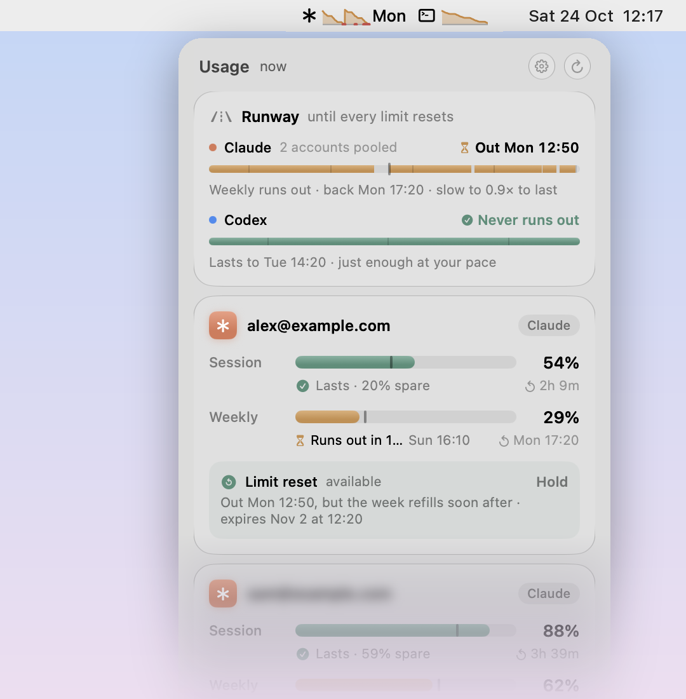
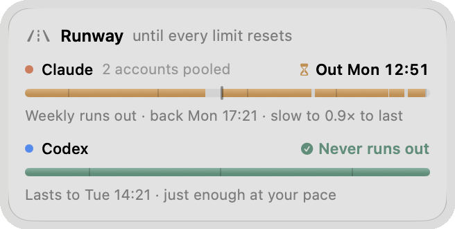
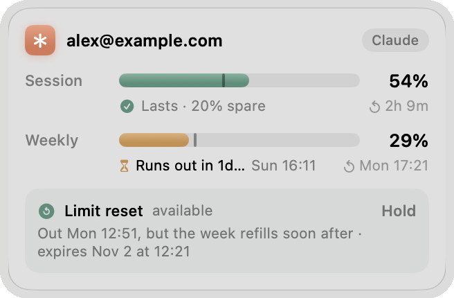
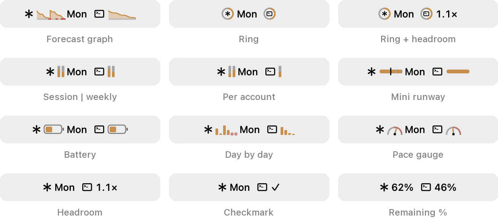
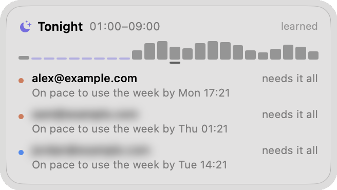

<h1 align="center">SubPacer</h1>

<p align="center">
  <b>Will your Claude and Codex limits last the week?</b><br>
  A macOS menu bar app that shows the quota left on every account in your
  <a href="https://github.com/router-for-me/CLIProxyAPI">CLIProxyAPI</a><br>
  and tells you, before it happens, whether your pace runs out first.
</p>

<p align="center">
  <a href="https://github.com/kcazin/SubPacer/releases/latest"><b>Download for macOS</b></a>
  &nbsp;·&nbsp; macOS 26 or later &nbsp;·&nbsp; free and open source
</p>

<p align="center">
  <picture>
    <source media="(prefers-color-scheme: dark)" srcset="docs/images/hero-dark.png">
    
  </picture>
</p>

## Know where you'll run out

The Runway pools each provider's accounts, the way the proxy fails over between them, and plays your week forward:
it follows the hours you usually work, and lets each limit refill as it resets. It shows whether you ever run out,
when, when you're back, and how much faster or slower you could go.

<p align="center">
  
</p>

## Every account at a glance

Each account shows its 5-hour session and weekly limit, when they reset, and whether you'll reach the reset at your
current pace or by how much you'd fall short. A one-off Claude limit reset shows up too, with when spending it buys
the most.

<p align="center">
  
</p>

## Your menu bar, your way

Twelve styles, from the forecast graph to a plain percentage, each previewed in settings with your own numbers.
With both providers, a compact mode keeps just the graphics.

<p align="center">
  
</p>

## Quiet hours, counted

SubPacer learns when you use the proxy and works out, for tonight, how much of each account's weekly quota you'd
never get to use before it resets. A good time to queue up a long job.

<p align="center">
  
</p>

## Install

1. [Download the latest zip](https://github.com/kcazin/SubPacer/releases/latest), unzip it and move SubPacer to
   Applications. It isn't notarized yet: open it once, then click **Open Anyway** in System Settings → Privacy &
   Security.
2. Give the proxy a management key, in its `config.yaml`, and restart it:

   ```yaml
   remote-management:
     secret-key: "pick-a-long-random-key"
   ```

3. Click SubPacer in the menu bar. **Find local** finds a proxy on this Mac (or type its URL); paste the key and
   **Connect**.

SubPacer updates itself from this repository's releases. A proxy on another machine, the settings and what's
stored where: [Connecting to your proxy](docs/PROXY.md).

No proxy at hand? `SUBPACER_DEMO=1 /Applications/SubPacer.app/Contents/MacOS/SubPacer` runs it on made-up accounts.

## Your tokens stay in the proxy

SubPacer asks the proxy to call the providers' usage endpoints, and the proxy fills in each account's token: the app
never sees a provider credential. The management key is kept in your Keychain and only sent to your proxy. Emails are
blurred until you click them, so the panel is safe to screenshot. Nothing leaves your Mac except to your proxy, and
to GitHub to check for updates.

> **Unofficial.** Quota comes from the same undocumented usage endpoints the providers' own CLIs use, which can change
> without notice. Not affiliated with Anthropic, OpenAI or the CLIProxyAPI project.

## For developers

Building from source, releases, the debug snapshots and adding a provider: [docs/DEVELOPMENT.md](docs/DEVELOPMENT.md).

MIT licensed: see [LICENSE](LICENSE).
