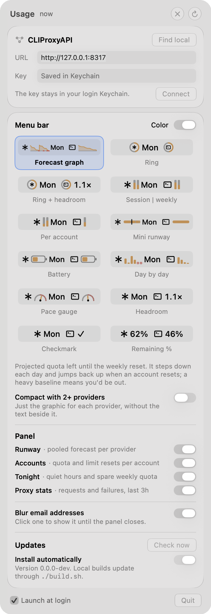

# Connecting to your proxy

How SubPacer reaches [CLIProxyAPI](https://github.com/router-for-me/CLIProxyAPI), what it keeps where, and the
settings. The [README](../README.md) has the short version.

## The management key

SubPacer uses CLIProxyAPI's management API, which is off until it has a key. In the proxy's `config.yaml`:

```yaml
remote-management:
  secret-key: "pick-a-long-random-key"   # the proxy hashes this on its next start
  allow-remote: false                    # true only if SubPacer runs on another machine
```

Restart the proxy, then click the SubPacer menu bar icon. On first run it shows a setup card:

1. **Find local** looks for a proxy on this Mac (port 8317, plus any `port:` from a `config.yaml` in
   `~/.cli-proxy-api`, `~/.config/cliproxyapi` or Homebrew's `etc`). Or type the URL.
2. Paste the key you chose above and click **Connect**. SubPacer checks it against the proxy before saving anything.

Change these later in settings (gear icon, ⌘,), which is also where you pick the menu bar style and which sections
the panel shows:

<p align="center">
  
</p>

## A proxy on another machine

It must be reached over `https://` (for example behind a reverse proxy or `tailscale serve`), since the key is sent
with every request. Plain `http://` is only accepted for `localhost`. Set `allow-remote: true` in the proxy's config.

## Security and privacy

- **Tokens stay in the proxy.** Quota requests go through the proxy's `/v0/management/api-call`, which inserts each
  account's token server-side. SubPacer never sees a provider credential.
- **The management key** lives in your login Keychain (service `SubPacer`, account `management-key`). It's written
  through `/usr/bin/security` on stdin, never on a command line.
- **No retry storms.** CLIProxyAPI bans an address for ~30 minutes after 5 failed logins, so after a rejected key
  SubPacer stops until you change the key or URL.
- **The key is only sent to the configured host.** Redirects are refused, and responses aren't cached to disk.
- **Emails are blurred** in the panel by default, so it's safe to screenshot. Click an address to show it until the
  panel closes; turn blurring off in settings.
- **Local data**: usage history and the learned activity profile are kept in
  `~/Library/Application Support/SubPacer`. Nothing is sent anywhere except your proxy (and, through it, the
  providers' usage endpoints) and GitHub's releases API, to check for updates.

## Updates

SubPacer checks this repository's latest release shortly after launch and every few hours. When there's a newer one
it downloads the zip, checks it against the SHA-256 GitHub publishes for it, replaces the app where it is and
restarts. Turn off **Install automatically** in settings to be asked first; **Check now** looks right away. The app's
folder must be writable by you (`/Applications` is for admin accounts, `~/Applications` always is).

If macOS still blocks the app after **Open Anyway**, clear the download flag:

```sh
xattr -dr com.apple.quarantine /Applications/SubPacer.app
```

## Configuration

| Setting | How |
| --- | --- |
| Proxy URL | Settings, or `defaults write dev.killian.subpacer proxyURL https://host:8317` |
| Management key | Settings, or `security add-generic-password -U -s SubPacer -a management-key -w` (prompts for it) |
| Overrides for one run | `SUBPACER_URL`, `SUBPACER_MANAGEMENT_KEY` environment variables |

SubPacer refreshes every 5 minutes and whenever the panel opens, and honors `Retry-After` from the providers' usage
APIs.
